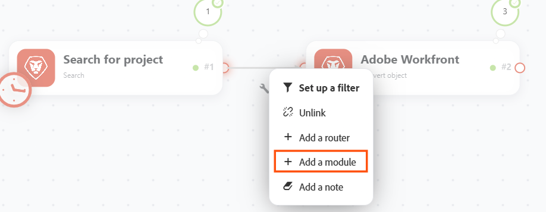

# 将模块添加到场景中

场景由一系列模块组成，这些模块会指示数据在应用程序内部如何转换，或在应用程序与网络服务之间如何传输。 您可以通过添加和配置模块来构建模块。

本文介绍了将模块添加到场景的基本过程。 有关添加方案的详细说明，请参阅[添加模块：文章索引](/help/workfront-fusion/create-scenarios/add-modules/add-modules-toc.md)下的其他文章。

>[!NOTE]
>
>Workfront Fusion正在将场景编辑器转换为新Experience。 在此过渡期间，经典体验和新体验均可用，您可以随时在它们之间切换。 我们建议使用新Experience。 有关详细信息，请参阅文章场景编辑器中的[新体验和经典体验](/help/workfront-fusion/get-started-with-fusion/navigate-fusion/scenario-editor.md#new-and-classic-experiences)。

## 访问权限要求

+++ 展开可查看本文所述功能的访问权限要求。

<table style="table-layout:auto">
 <col> 
 <col> 
 <tbody> 
  <tr> 
   <td role="rowheader">Adobe Workfront 包</td> 
   <td> 
任意 Adobe Workfront Workflow 包以及任意 Adobe Workfront 自动化和集成包

Workfront Ultimate

Workfront Prime 和 Select 包，且需额外购买 Workfront Fusion。
 </td> 
  </tr> 
  <tr data-mc-conditions=""> 
   <td role="rowheader">Adobe Workfront 许可证</td> 
   <td> 
标准

工作版或更高版本
 </td> 
  </tr> 
  <tr> 
   <td role="rowheader">产品</td> 
   <td>
   
如果您的组织使用的 Workfront Select 或 Prime 包不包含 Workfront 自动化和集成，则必须单独购买 Adobe Workfront Fusion。</li></ul>
   </td> 
  </tr>
 </tbody> 
</table>

有关此表中信息的更多详细说明，请参阅[文档中的访问权限要求](/help/workfront-fusion/references/licenses-and-roles/access-level-requirements-in-documentation.md)。

+++

## 将第一个模块添加到方案

方案的第一个模块通常是触发器模块。

有关触发器模块的详细信息，请参阅文章模块概述中的[触发器模块](/help/workfront-fusion/get-started-with-fusion/understand-fusion/module-overview.md#trigger-modules)。

* [在新版Experience中添加第一个模块（推荐）](#add-the-first-module-in-the-new-experience-recommended)
* [在经典体验中添加第一个模块](#add-the-first-module-in-the-classic-experience)

### 在新版Experience中添加第一个模块（推荐）

1. 单击左侧面板中的&#x200B;**[!UICONTROL 方案]**&#x200B;选项卡。
1. 通过单击屏幕右上角的&#x200B;**创建新方案**&#x200B;开始创建方案。

   这将打开场景编辑器，其中包含占位符模块和可用连接器的列表。

   

   

1. 选择将启动此方案的连接器或webhook：

   * 使用左侧的面板（[!UICONTROL 收藏夹]、[!UICONTROL 所有应用程序]、[!UICONTROL Adobe Workfront]、[!UICONTROL Adobe Firefly Services]、[!UICONTROL Adobe Creative和内容]、[!UICONTROL Adobe Cloud Services]、[!UICONTROL 生成AI]或[!UICONTROL 内置]）按类别浏览，或
   * 在搜索框中输入搜索词。 键入时将更新结果，在模块名称和说明匹配之前列出连接器匹配项。

1. 单击要添加到方案中的模块。

1. 配置模块。

   模块设置将在画布右侧的面板中打开。

   有关配置特定模块的说明，请参阅[Fusion应用程序及其模块引用中列出的选定应用程序的文章：文章索引](/help/workfront-fusion/references/apps-and-modules/apps-and-modules-toc.md)。

>[!NOTE]
>
>* 在连接器列表中，徽章用于标识私有、高级和测试版应用程序。
>* 将大型应用程序的模块划分到不同的组中。
>* 添加错误处理程序时，首先列出指令。
>* 如果连接器具有多个版本，则在选择该连接器后，您将能够选择该版本。

>[!NOTE]
>
>如果您已从场景中删除第一个模块并想要替换它，请单击占位符模块以打开连接器列表。

### 在经典体验中添加第一个模块

1. 单击左侧面板中的&#x200B;**[!UICONTROL 方案]**&#x200B;选项卡。
1. 通过单击屏幕右上角的&#x200B;**创建新方案**&#x200B;开始创建方案。

   场景编辑器将打开，其中包含占位符（问号）模块和可用连接器的列表。

   

1. 选择将启动此方案的连接器或webhook。 您可以在列表的搜索栏中键入连接器的名称，以筛选列表。
1. 配置模块。

   有关配置特定模块的说明，请参阅[Fusion应用程序及其模块引用中列出的选定应用程序的文章：文章索引](/help/workfront-fusion/references/apps-and-modules/apps-and-modules-toc.md)。

>[!NOTE]
>
>如果您已从场景中删除第一个模块并想要替换它，请单击占位符（问号）模块以打开连接器列表。

## 向方案添加其他模块

* [在新版Experience中添加另一个模块（推荐）](#add-another-module-in-the-new-experience-recommended)
* [在经典体验中添加另一个模块](#add-another-module-in-the-classic-experience)

### 在新版Experience中添加另一个模块（推荐）

1. 如果您不在要添加模块的方案的方案编辑器中，请单击左侧面板中的&#x200B;**[!UICONTROL 方案]**&#x200B;选项卡。
1. 单击方案上的任意位置以进入方案编辑器。
1. 要在其他模块之后添加模块，请将鼠标悬停在模块的右边缘上，以便在该边缘之后添加模块，然后在其出现时单击&#x200B;**添加其他模块**。

   此时将打开连接器列表，其中显示了场景中已使用的任何连接器。

1. （可选）要选择其他连接器，请单击&#x200B;**在列表中添加其他模块**，然后选择连接器：

   * 使用左侧的面板（[!UICONTROL 收藏夹]、[!UICONTROL 所有应用程序]、[!UICONTROL Adobe Workfront]、[!UICONTROL Adobe Firefly Services]、[!UICONTROL Adobe Creative和内容]、[!UICONTROL Adobe Cloud Services]、[!UICONTROL 生成AI]或[!UICONTROL 内置]）按类别浏览，或
   * 在搜索框中输入搜索词。 键入时将更新结果，在模块名称和说明匹配之前列出连接器匹配项。

1. 单击要添加到方案中的模块。

1. 配置模块。

   模块设置将在画布右侧的面板中打开。

   有关配置特定模块的说明，请参阅[Fusion应用程序及其模块引用中列出的选定应用程序的文章：文章索引](/help/workfront-fusion/references/apps-and-modules/apps-and-modules-toc.md)。

### 在经典体验中添加另一个模块

1. 如果您不在要添加模块的方案的方案编辑器中，请单击左侧面板中的&#x200B;**[!UICONTROL 方案]**&#x200B;选项卡。
1. 单击方案上的任意位置以进入方案编辑器。
1. 若要将某个模块添加到另一个模块，请将鼠标悬停在该模块的右侧句柄上，以便在该句柄之后添加模块，然后在该模块出现时单击&#x200B;**添加另一个模块**。

   此时将打开连接器列表，其中显示了场景中已使用的任何连接器。

1. （可选）要选择其他连接器，请单击&#x200B;**在列表中添加其他模块**，然后选择连接器。 您可以在列表的搜索栏中键入连接器的名称，以筛选列表。
1. 配置模块。

   有关配置特定模块的说明，请参阅[Fusion应用程序及其模块引用中列出的选定应用程序的文章：文章索引](/help/workfront-fusion/references/apps-and-modules/apps-and-modules-toc.md)。

## 在场景中的现有模块之间插入模块

* [在新版Experience中插入模块（推荐）](#insert-a-module-in-the-new-experience-recommended)
* [在经典体验中插入模块](#insert-a-module-in-the-classic-experience)

### 在新版Experience中插入模块（推荐）

1. 如果您不在要添加模块的方案的方案编辑器中，请单击左侧面板中的&#x200B;**[!UICONTROL 方案]**&#x200B;选项卡。
1. 单击方案上的任意位置以进入方案编辑器。
1. 右键单击要插入模块的模块之间的路径，然后选择&#x200B;**添加模块**。

   

   此时将打开连接器列表，其中显示了场景中已使用的任何连接器。

1. （可选）要选择其他连接器，请单击&#x200B;**在列表中添加其他模块**，然后选择连接器：

   * 使用左侧的面板（[!UICONTROL 收藏夹]、[!UICONTROL 所有应用程序]、[!UICONTROL Adobe Workfront]、[!UICONTROL Adobe Firefly Services]、[!UICONTROL Adobe Creative和内容]、[!UICONTROL Adobe Cloud Services]、[!UICONTROL 生成AI]或[!UICONTROL 内置]）按类别浏览，或
   * 在搜索框中输入搜索词。 键入时将更新结果，在模块名称和说明匹配之前列出连接器匹配项。

1. 单击要添加到方案中的模块。

1. 配置模块。

   模块设置将在画布右侧的面板中打开。

   有关配置特定模块的说明，请参阅[Fusion应用程序及其模块引用中列出的选定应用程序的文章：文章索引](/help/workfront-fusion/references/apps-and-modules/apps-and-modules-toc.md)。

>[!NOTE]
>
>要创建指向特定模块的链接，请在查看以下页面时将`?moduleId=<module-id>`添加到URL：
>
>* 方案编辑页面（URL以`/edit`结尾）
>* 特定场景执行（URL以`/logs/<log-id>`结尾）
>
>查看场景时，`<module-id>`引用模块标签旁边的数字。
>
>这在调试方案或复制模块配置时可能很有用。

### 在经典体验中插入模块

1. 如果您不在要添加模块的方案的方案编辑器中，请单击左侧面板中的&#x200B;**[!UICONTROL 方案]**&#x200B;选项卡。
1. 单击方案上的任意位置以进入方案编辑器。
1. 单击要插入模块的模块之间的点状路径。
1. 在出现的菜单中，选择&#x200B;**添加模块**。

此时将打开连接器列表，其中显示了场景中已使用的任何连接器。

1. （可选）要选择其他连接器，请单击&#x200B;**在列表中添加其他模块**，然后选择连接器。 您可以在列表的搜索栏中键入连接器的名称，以筛选列表。
1. 配置模块。

   有关配置特定模块的说明，请参阅[Fusion应用程序及其模块引用中列出的选定应用程序的文章：文章索引](/help/workfront-fusion/references/apps-and-modules/apps-and-modules-toc.md)。

>[!NOTE]
>
>要创建指向特定模块的链接，请在查看以下页面时将`?moduleId=<module-id>`添加到URL：
>
>* 方案编辑页面（URL以`/edit`结尾）
>* 特定场景执行（URL以`/logs/<log-id>`结尾）
>
>查看场景时，`<module-id>`引用模块标签旁边的数字。
>
>这在调试方案或复制模块配置时可能很有用。
