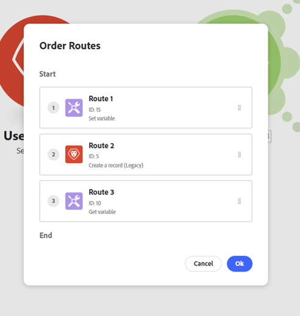
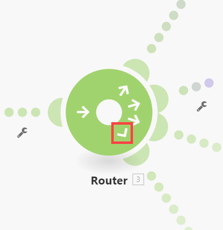
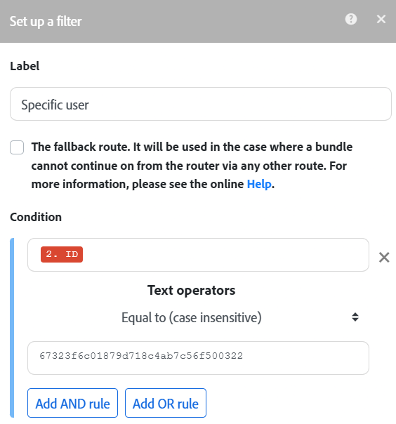

# 添加路由器模块并配置路由

路由器模块允许您将方案分为多条路由，并以不同的方式处理每条路由中的数据。 当路由器模块收到捆绑包时，它会按照路由连接到路由器模块的顺序将其转发到每个连接的路由。

路由是按顺序处理的，而不是并行处理的。 直到上一路由完全处理完某个捆绑包后，该捆绑包才会发送到下一路由。

>[!NOTE]
>
>Workfront Fusion正在将场景编辑器转换为新Experience。 在此过渡期间，经典体验和新体验均可用，您可以随时在它们之间切换。 我们建议使用新Experience。 有关详细信息，请参阅文章场景编辑器中的[新体验和经典体验](/help/workfront-fusion/get-started-with-fusion/navigate-fusion/scenario-editor.md#new-and-classic-experiences)。

## 访问权限要求

+++ 展开可查看本文所述功能的访问权限要求。

<table style="table-layout:auto">
 <col> 
 <col> 
 <tbody> 
  <tr> 
   <td role="rowheader">Adobe Workfront 包</td> 
   <td> 
任意 Adobe Workfront Workflow 包以及任意 Adobe Workfront 自动化和集成包

Workfront Ultimate

Workfront Prime 和 Select 包，且需额外购买 Workfront Fusion。
 </td> 
  </tr> 
  <tr data-mc-conditions=""> 
   <td role="rowheader">Adobe Workfront 许可证</td> 
   <td> 
标准

工作版或更高版本
 </td> 
  </tr> 
  <tr> 
   <td role="rowheader">产品</td> 
   <td>
   
如果您的组织使用的 Workfront Select 或 Prime 包不包含 Workfront 自动化和集成，则必须单独购买 Adobe Workfront Fusion。</li></ul>
   </td> 
  </tr>
 </tbody> 
</table>

有关此表中信息的更多详细说明，请参阅[文档中的访问权限要求](/help/workfront-fusion/references/licenses-and-roles/access-level-requirements-in-documentation.md)。

+++

## 向方案添加路由器模块

在配置路由之前，必须添加路由器模块。

* [将路由器模块添加到新版Experience中的场景（推荐）](#add-a-router-module-to-a-scenario-in-the-new-experience-recommended)
* [将路由器模块添加到经典体验中的场景](#add-a-router-module-to-a-scenario-in-the-classic-experience)

### 将路由器模块添加到新版Experience中的场景（推荐）

1. 单击左侧面板中的&#x200B;**[!UICONTROL 方案]**&#x200B;选项卡。
1. 选择要添加路由器的方案。
1. 单击方案上的任意位置以进入方案编辑器。
1. 将鼠标悬停在要添加路由器的模块的右边缘上，然后在出现时单击&#x200B;**[!UICONTROL 添加其他模块]**。 在打开的列表中，选择&#x200B;**[!UICONTROL 内置]**&#x200B;类别，然后选择&#x200B;**[!UICONTROL 流量控制]** > **[!UICONTROL 路由器]**。

   或

   要在两个模块之间插入路由器模块，请右键单击连接两个模块的路径，然后选择&#x200B;**[!UICONTROL 添加路由器]**。

   

1. 通过将鼠标悬停在路由器的右边缘上并添加模块（类似于添加任何模块），向路由器添加第一条路由。
1. 要添加另一条路由，请单击路由器模块。 将出现一条路由。 根据需要向此路由添加模块。

   您可以添加任意数量的路由。

1. 要验证路由的顺序，请检查每个路由的标签。 首先执行Route 1 ，然后执行Route 2 ，依此类推。

   或

   在控件区域中单击&#x200B;**自动对齐**&#x200B;图标。

   这些路由按其执行顺序排列。 首先执行顶层路由。

1. （可选）要更改路由顺序，请右键单击路由器模块并选择&#x200B;**对路由排序**。 按照您希望路由执行的顺序拖放路由。 路由由路由器后面的第一个模块（路由的第一个模块）标记。
1. （可选）要禁用路由，请右键单击从路由器通向该路由的路径，然后选择&#x200B;**禁用路由**。

   禁用的路由显示从路由器到路由中第一个模块的灰色圆点，并在标签上显示禁用的路由图标。

1. （可选且有条件）要启用禁用的路由，请单击路由标签上的禁用的路由图标。
1. 继续[向新体验中的路由添加筛选器](#add-a-filter-to-a-route-in-the-new-experience-recommended)。

### 将路由器模块添加到经典体验中的场景

1. 单击左侧面板中的&#x200B;**[!UICONTROL 方案]**&#x200B;选项卡。
1. 选择要添加路由器的方案。
1. 单击方案上的任意位置以进入方案编辑器。
1. 在方案编辑器中，单击要添加路由器的模块的右句柄，然后在显示的模块列表中选择&#x200B;**[!UICONTROL 流量控制]** > **路由器**。

   

   或

   要在两个模块之间插入路由器模块，请单击连接两个模块的路由下面的扳手图标，然后从菜单中选择&#x200B;**[!UICONTROL 添加路由器]**。

   
1. 通过单击路由器的右侧句柄并添加模块（类似于添加任何模块），向路由器添加第一条路由。
1. 要添加另一条路由，请单击路由器模块。 将出现一条路由。 根据需要向此路由添加模块。

   您可以添加任意数量的路由。

1. 要验证路由的顺序，请检查每个路由的标签。 首先执行Route 1 ，然后执行Route 2 ，依此类推。

   或

   单击自动对齐图标。

   这些路由按其执行顺序排列。 首先执行顶层路由。

1. （可选）要更改路由顺序，请右键单击路由器模块，然后选择&#x200B;**对路由排序**&#x200B;按您希望路由执行的顺序拖放路由。 路由由路由器后面的第一个模块（路由的第一个模块）标记。

   

1. （可选）要禁用路由，请右键单击从路由器通向该路由的点，然后选择&#x200B;**禁用路由**。

   禁用的路由显示从路由器到路由中第一个模块的灰色圆点，并在标签上显示禁用的路由图标。

1. （可选且有条件）要启用禁用的路由，请单击路由标签上的禁用的路由图标。
1. 继续[向经典体验中的路由添加筛选器](#add-a-filter-to-a-route-in-the-classic-experience)。

## 将过滤器添加到工艺路线

您可以在路由器模块后面的路由上放置过滤器以过滤捆绑包。 只有通过过滤器的捆绑包才会由路由上的模块处理。

如果数据通过多条路由的过滤，则数据由两条路由处理。 顶部路由首先处理数据。

带有过滤器的路由器在路由标签上显示过滤器图标。

* [向新体验中的路由添加过滤器（推荐）](#add-a-filter-to-a-route-in-the-new-experience-recommended)
* [在经典体验中添加过滤器到路由](#add-a-filter-to-a-route-in-the-classic-experience)

### 向新体验中的路由添加过滤器（推荐）

1. 单击左侧面板中的&#x200B;**[!UICONTROL 方案]**&#x200B;选项卡。
1. 选择要添加过滤器的方案。
1. 单击方案上的任意位置以进入方案编辑器。
1. 左键单击要设置过滤器的路径。 这是路由器模块与路由的第一个模块之间的路径。

   将直接打开&#x200B;**[!UICONTROL 设置过滤器]**&#x200B;窗口。

1. 在显示的面板的标签字段中，添加标签。 此标签显示在方案中。
1. 配置筛选条件。

   有关更多信息，请参阅[向场景添加筛选条件](/help/workfront-fusion/create-scenarios/add-modules/add-a-filter-to-a-scenario.md)。

   

1. 单击&#x200B;**[!UICONTROL 确定]**&#x200B;以保存筛选器设置。
1. （视情况而定）如果过滤器名称太长而无法放入标签，请将光标悬停在标签上以显示整个名称。

1. 继续[在新体验](#configure-a-fallback-route-in-the-new-experience-recommended)中配置后备路由。

### 在经典体验中添加过滤器到路由

1. 单击左侧面板中的&#x200B;**[!UICONTROL 方案]**&#x200B;选项卡。
1. 选择要添加过滤器的方案。
1. 单击方案上的任意位置以进入方案编辑器。
1. 单击要设置过滤器的路径上的扳手图标。 这是路由器模块与路由的第一个模块之间的路径。
1. 选择&#x200B;**设置筛选器。**
1. 在显示的面板的标签字段中，添加标签。 此标签显示在方案中。
1. 配置筛选条件。

   有关更多信息，请参阅[向场景添加筛选条件](/help/workfront-fusion/create-scenarios/add-modules/add-a-filter-to-a-scenario.md)。

1. 单击&#x200B;**[!UICONTROL 确定]**&#x200B;以保存筛选器设置。
1. （视情况而定）如果过滤器名称太长而无法放入标签，请将光标悬停在标签上以显示整个名称。

1. 继续[在经典Experience](#configure-a-fallback-route-in-the-classic-experience)中配置回退路由。

## 配置后备路由

回退路由是在未将任何过滤器传递到另一路由的任何捆绑上执行的路由。

备用路由在标签上显示“备用”。

您可以在过滤器面板中启用回退路由。

* [在新版Experience中配置后备路由（推荐）](#configure-a-fallback-route-in-the-new-experience-recommended)
* [在经典体验中配置后备路由](#configure-a-fallback-route-in-the-classic-experience)

### 在新版Experience中配置后备路由（推荐）

1. 单击左侧面板中的&#x200B;**[!UICONTROL 方案]**&#x200B;选项卡。
1. 选择要添加回退路由的方案。
1. 单击方案上的任意位置以进入方案编辑器。
1. 左键单击要设置过滤器的路径。 这是路由器模块与路由的第一个模块之间的路径。

   将直接打开&#x200B;**[!UICONTROL 设置过滤器]**&#x200B;窗口。

1. 在显示的面板的标签字段中，添加标签。 此标签显示在方案中。
1. 启用后备路由复选框。

   

1. 单击&#x200B;**[!UICONTROL 确定]**&#x200B;以保存筛选器设置。

回退路由的标签以绿色显示&#x200B;**回退**。

### 在经典体验中配置后备路由

1. 单击左侧面板中的&#x200B;**[!UICONTROL 方案]**&#x200B;选项卡。
1. 选择要添加回退路由的方案。
1. 单击方案上的任意位置以进入方案编辑器。
1. 单击要设置过滤器的路径上的扳手图标。 这是路由器模块与路由的第一个模块之间的路径。
1. 选择&#x200B;**设置筛选器。**
1. 在显示的面板的标签字段中，添加标签。 此标签显示在方案中。
1. 启用后备路由复选框。

   

1. 单击&#x200B;**[!UICONTROL 确定]**&#x200B;以保存筛选器设置。

备用路由在路由器模块中用不同的箭头标记：

## 折叠路由器

>[!NOTE]
>
>此功能仅在新的方案编辑器体验中可用。

在新版Experience中，您可以折叠路由器以暂时隐藏其路由。 这在大情况下很有用。

1. 在方案编辑器中以编辑模式打开方案。
1. 右键单击要折叠的路由器，然后选择&#x200B;**折叠路由**

折叠的路由器显示隐藏的路由和模块数，包括隐藏警告或错误的严重程度。

折叠路由器不会移除或禁用任何内容。 当需要显示折叠路由器内部的模块时，搜索、验证、实时跟踪和执行历史记录会自动将其展开。

折叠状态与场景一起保存，并可与撤消和重做配合使用。 当您查看方案执行时，将始终显示完整的方案。

## 示例：`if/else`用例

>[!BEGINSHADEBOX]

备用路由的典型使用情形是，如果满足条件，则使用一条路由继续流，如果不满足，则使用另一条路由。 与以下步骤相同：

在本例中，第一条路由配置有过滤器。 这表示`if`组件。

中设置筛选器

第二路由被配置为后备路由。 这表示`else`组件。

>[!ENDSHADEBOX]
