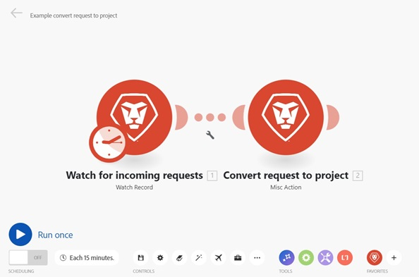
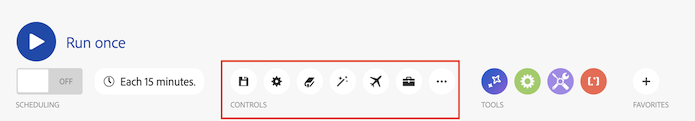

# 方案编辑器

利用方案编辑器，可在可视化界面中创建和编辑方案。

新的方案编辑器体验：

经典场景编辑器体验

## 访问权限要求

+++ 展开可查看本文所述功能的访问权限要求。

<table style="table-layout:auto">
 <col> 
 <col> 
 <tbody> 
  <tr> 
   <td role="rowheader">Adobe Workfront 包</td> 
   <td> 
任意 Adobe Workfront Workflow 包以及任意 Adobe Workfront 自动化和集成包

Workfront Ultimate

Workfront Prime 和 Select 包，且需额外购买 Workfront Fusion。
 </td> 
  </tr> 
  <tr data-mc-conditions=""> 
   <td role="rowheader">Adobe Workfront 许可证</td> 
   <td> 
标准

工作版或更高版本
 </td> 
  </tr> 
  <tr> 
   <td role="rowheader">产品</td> 
   <td>
   
如果您的组织使用的 Workfront Select 或 Prime 包不包含 Workfront 自动化和集成，则必须单独购买 Adobe Workfront Fusion。</li></ul>
   </td> 
  </tr>
 </tbody> 
</table>

有关此表中信息的更多详细说明，请参阅[文档中的访问权限要求](/help/workfront-fusion/references/licenses-and-roles/access-level-requirements-in-documentation.md)。

+++

## 新体验和经典体验

Workfront Fusion正在将场景编辑器转换为新Experience。 在此过渡期间，经典体验和新体验均可用，您可以随时在它们之间切换。 我们建议使用新Experience。

新体验包括：

* 重新设计的画布，带有卡片式模块、小型地图和缩放控件。
* 新的方案编辑器控件，包括“查找和替换”、“代码片段”和“撤消/重做”。
* 询问AI按钮。
* 更新了连接器选取器，具有类别导航和将收藏夹标记为内联的功能。
* 一种深色模式，它遵循您的外观设置。
* 折叠路由器以隐藏其路由的功能。
* [Live Trail](/help/workfront-fusion/manage-scenarios/live-trail.md)，一个显示场景运行情况的面板。
* 场景编辑器中现在内置了多个开发人员工具。
* 临时调试日志，您可以在场景设置中打开该日志。

要在经典体验和新体验之间切换，请执行以下操作：

1. 在方案编辑器中，找到右上角的&#x200B;**[!UICONTROL 尝试新设计]**&#x200B;切换开关。
1. 单击切换可切换到新体验。
1. 要返回到经典体验，请再次单击切换开关。

切换时，场景会重新加载。 您的选择会为用户保存，因此不会更改您的队友看到的体验。 切换不会更改场景本身。

如果未看到该切换开关，则您的组织可能还无法使用新体验。 联系Workfront Fusion管理员。

## 在新版Experience中使用场景编辑器（推荐）

* [打开方案编辑器并添加模块：](#open-the-scenario-editor-and-add-a-module)
* [可用的方案编辑器操作](#available-scenario-editor-actions)

### 打开方案编辑器并添加模块：

1. 单击左侧面板中的&#x200B;**[!UICONTROL 方案]** 。
1. 单击占位符模块以打开应用程序和服务列表。
1. 选择要以开始的应用程序或服务：

   * 使用左侧的面板（[!UICONTROL 收藏夹]、[!UICONTROL 所有应用程序]、[!UICONTROL Adobe Workfront]、[!UICONTROL Adobe Firefly Services]、[!UICONTROL Adobe Creative和内容]、[!UICONTROL Adobe Cloud Services]、[!UICONTROL 生成AI]或[!UICONTROL 内置]）按类别浏览。
   * 在搜索框中输入搜索词以筛选列表。
   * 要将连接器添加到收藏夹，请将鼠标悬停在连接器上，然后单击连接器旁边的星形图标。

   有关配置模块的详细信息，请参阅[配置模块](/help/workfront-fusion/create-scenarios/add-modules/configure-a-modules-settings.md)。

### 可用的方案编辑器操作

* [编辑操作](#editing-actions)
* [日程计划](#scheduling)
* [控件](#controls)
* [工具](#tools)
* [收藏夹](#favorites)
* [咨询AI](#ask-ai)
* [画布导航](#canvas-navigation)
* [画布显示](#canvas-display)

#### 编辑操作

这些操作在屏幕顶部而非底部工具栏中可用。

| 操作 | 详细信息 |
| ---------- | ---------- |
| 方案名称 | 方案的名称显示在屏幕的左上方。 要重命名方案，请单击名称并输入新名称。 |
| 紧凑视图 | 切换视图，画布上的模块将缩小为小图块，网格将变紧，长模块名称将换行而不是被切断。 切换视图不会重新加载场景。 |
| 反馈 | 发送有关新体验的反馈。 此按钮位于场景编辑器的右上角，在紧凑视图切换旁边。 |
| 撤消  | 撤消最近的操作，最近的操作放在最前面。 只能撤消当前会话中的操作。 |
| 重做  | 重做最近的操作。 只能从当前会话中重做操作。 |
| 历史记录  | 查看此会话中所做更改的历史记录。 您还可以撤消所有会话更改。 |

#### 日程计划

| 操作 | 详细信息 |
| ---------- | ---------- |
| 运行一次 | 运行一次在新设计中是仅用于图标的。 将鼠标悬停在该图标上可查看&#x200B;**[!UICONTROL 运行一次]**&#x200B;工具提示。 在激活场景之前，您可以在此处测试运行场景并验证场景是否按预期运行 |
| 激活切换 | 激活或取消激活您的方案。 在激活它后，场景将根据其计划执行。 |
| 计划方案 | 默认情况下，具有轮询触发器的方案每15分钟运行一次。 您可以通过定义激活方案运行的时间和频率来更改此设置。 轮询的融合场景可以计划为每5分钟运行一次。 有关详细信息，请参阅[计划方案](/help/workfront-fusion/create-scenarios/config-scenarios-settings/schedule-a-scenario.md)。 |

#### 控件

您可能需要单击“控件”区域中的三个点图标来查看其中的某些控件。

| 操作 | 详细信息 |
| ---------- | ---------- |
| 进行保存 

 | 
保存场景后，三个点菜单下将显示一个新版本，以防您未来需要访问它。 之前保存的方案版本将在创建下一个方案版本后的60天内可用。 

为了保留超过60天的方案版本历史记录以供审核之用，我们建议将方案的蓝图保存并存档到其他位置。
 |
| 方案设置 

 | 方案设置面板包含方案的高级设置。 有关可用设置的详细信息，请参阅[配置方案设置](/help/workfront-fusion/create-scenarios/config-scenarios-settings/configure-scenario-settings.md)。 不会为每次运行保留请求和响应详细信息。 要为方案的常规运行收集这些日志，请打开临时调试日志。 有关详细信息，请参阅[临时调试日志](/help/workfront-fusion/create-scenarios/config-scenarios-settings/configure-scenario-settings.md#temporary-debug-logs)。 |
| 注释 

 | 记录方案。 其他用户可以在场景中查看这些注释。 有关详细信息，请参阅[向方案添加注释](/help/workfront-fusion/create-scenarios/config-scenarios-settings/add-notes-to-scenario.md)。 |
| 自动对齐 

 | 自动对齐场景中的模块。 |
| 搜索模块 

 | 从该列表中选择一个模块，转到场景中的该模块，或输入搜索词以查找模块，然后单击要转到该模块的搜索结果。 您可以按模块名称、ID、类型或应用程序进行搜索。 |
| 查找和替换 

 | 
在方案的模块中搜索和替换变量、映射的值源或连接。 使用选项卡可以：
<ul><li>在整个场景中或在一个模块中替换映射的变量。</li><li>将引用从一个源模块重新映射到另一个源模块。</li><li>将连接从同一应用程序复制到一个或所有兼容的模块。</li></ul>
在进行更改之前，该面板会预览将受影响的模块。 在预览中选择一行以转到画布上的该模块。
 
有关详细信息，请参阅[查找并替换方案中的变量、源和连接](/help/workfront-fusion/manage-scenarios/find-and-replace.md)。
 |
| 片段 

 | 
片段是另存为单位的方案部分。 要创建模块，请选择模块并将其另存为代码片段。 在“代码片段”面板中，您可以搜索、标记、预览、固定、排序和拖放代码片段，还可以导入和导出它们。 您可以与团队或组织共享代码片段，或直接将副本发送给其他用户。 共享代码片段将显示在其自己的选项卡中。
 
有关详细信息，请参阅[保存和重用包含代码片段的方案部分](/help/workfront-fusion/create-scenarios/add-modules/use-snippets.md)。
 |
| 说明流程 

 | 查看动画，其中移动圆点显示数据如何在场景中流动。 |
| 导出Blueprint 

 | 导出当前方案的蓝图。 有关详细信息，请参阅[复制模块或方案](/help/workfront-fusion/create-scenarios/add-modules/copy-modules-or-scenarios.md)。 |
| 导出为Headless模板 

 | 将方案导出为Headless模板。 |
| 导入Blueprint 

 | 导入之前导出的方案Blueprint。 有关详细信息，请参阅[复制模块或方案](/help/workfront-fusion/create-scenarios/add-modules/copy-modules-or-scenarios.md)。 |
| DevTool 

 | 使用DevTool，您可以检查场景的所有手动运行，查看所有执行的操作，并查看执行的每个API调用的详细信息。 您可以查看导致错误的模块、操作或单个响应，并使用该知识来优化场景。 有关详细信息，请参阅[调试方案](/help/workfront-fusion/manage-scenarios/debug-a-scenario.md)。 |
| 先前版本 

 | 查看此方案的先前版本。 有关详细信息，请参阅[查看和管理方案版本](/help/workfront-fusion/manage-scenarios/restore-a-scenario-version.md)。 |

#### 工具

| 操作 | 详细信息 |
| ---------- | ---------- |
| 流量控制 | 配置设置以控制数据流经场景的方式。 有关详细信息，请参阅[流量控制](/help/workfront-fusion/references/apps-and-modules/tools-and-transformers/flow-control.md)。 |
| 工具 | 工具部分包含几个可以增强方案的有用模块。 有关详细信息，请参阅[工具](/help/workfront-fusion/references/apps-and-modules/tools-and-transformers/tools-modules.md)。 |
| 文本分析器 | 使用文本解析器工具解析文本，以供在其他方案模块中使用。 有关详细信息，请参阅[文本分析器](/help/workfront-fusion/references/apps-and-modules/tools-and-transformers/text-parser.md)。 |

#### 收藏夹

您可以使用“收藏夹”图标添加常用模块。

| 操作 | 详细信息 |
| ---------- | ---------- |
| 您喜爱的连接器 | 此处显示您已标记为收藏的连接器。 |
| “添加收藏夹”图标 | 单击此图标可选择要添加到收藏夹部分的另一个连接器。 |
| “溢出”图标 | 如果您的收藏夹超出工具栏的容纳范围，则会显示一个溢出（三个点）图标，以便您可以访问其余收藏夹。 |

#### 咨询AI

单击&#x200B;**询问AI**&#x200B;以打开Adobe的AI助手。 根据您组织的AI设置，此选项可能不可用。

#### 画布导航

| 操作 | 详细信息 |
| ---------- | ---------- |
| 放大/缩小 | 放大或缩小画布视图。 |
| Focus | 返回到屏幕上适合您整个场景的视图。 |
| 微型图 | 查看整个方案的缩略图概述。 微型图显示您当前的视区。 在画布内单击，或者单击并拖动以在画布周围移动。 |

#### 画布显示

新画布还会更改您工作时场景的外观。

| 功能 | 详细信息 |
| ---------- | ---------- |
| 模块卡 | 每个模块都是一个水平信息卡，用于显示应用程序图标、模块名称、描述和模块ID。 路由器显示为紧凑的分支图块，指令显示为小重点卡。 |
| 链接 | 模块之间的链接是弯曲的，以表示方向的箭头结尾。 错误处理程序链接为虚线。 |
| 模块状态 | 绿色、黄色和红色指示器显示每个模块的状态。 |
| 缩放详细信息 | 放大时将显示信息卡详细信息。 缩小时，模块会简化为图标，以便您仍然可以查看整个场景。 |
| 折叠路由器 | 在编辑模式下，可以折叠路由器以隐藏其路由。 有关详细信息，请参阅[折叠路由器](/help/workfront-fusion/create-scenarios/add-modules/router-module.md#fold-a-router)。 |
| 深色模式 | 画布将遵循Adobe首选项下的深色外观设置，包括模块卡片、链接、面板、控件和状态信息。 |
| 右侧面板 | 在画布右侧的同一面板中打开模块设置、模块检查、模块浏览器、查找和替换、代码片段、[实时跟踪](/help/workfront-fusion/manage-scenarios/live-trail.md)以及请求和响应详细信息。 |

## 在经典体验中使用场景编辑器

* [打开方案编辑器并添加模块： (Classic)](#open-the-scenario-editor-and-add-a-module-classic)
* [可用的方案编辑器操作(Classic)](#available-scenario-editor-actions-classic)

### 打开方案编辑器并添加模块： (Classic)

1. 单击左侧面板中的&#x200B;**[!UICONTROL 方案]** 。
1. 单击问号图标，然后查找并单击要开始使用的应用程序或服务。 有关配置模块的详细信息，请参阅[配置模块](/help/workfront-fusion/create-scenarios/add-modules/configure-a-modules-settings.md)。

### 可用的方案编辑器操作(Classic)

* [运行场景(Classic)](#run-your-scenario-classic)
* [计划（经典）](#scheduling-classic)
* [控件（经典）](#controls-classic)
* [工具（经典）](#tools-classic)
* [收藏夹(Classic)](#favorites-classic)

#### 运行场景(Classic)

| 操作 | 详细信息 |
|----------|----------|
| 测试运行场景 | 在激活方案之前，请验证方案是否按预期运行。 一旦激活，场景将根据其计划执行。 如果所有组件都未按预期运行，请参阅[添加错误处理](/help/workfront-fusion/create-scenarios/config-error-handling/error-handling.md)以了解如何处理错误。 |

#### 计划（经典）

| 操作 | 详细信息 |
| ---------- | ---------- |
| 计划方案 | 默认情况下，场景每15分钟运行一次。 您可以通过定义激活方案运行的时间和频率来更改此设置。 融合场景可以计划为每5分钟运行一次。 有关详细信息，请参阅[计划方案](/help/workfront-fusion/create-scenarios/config-scenarios-settings/schedule-a-scenario.md)。 |

#### 控件（经典）

您可能需要单击“控件”区域中的三个点图标来查看其中的某些控件。

| 操作 | 详细信息 |
| ---------- | ---------- |
| 进行保存 

 | 
保存场景后，三个点菜单下将显示一个新版本，以防您未来需要访问它。 之前保存的方案版本将在创建下一个方案版本后的60天内可用。 

为了保留超过60天的方案版本历史记录以供审核之用，我们建议将方案的蓝图保存并存档到其他位置。
 |
| 方案设置 

 | 方案设置面板包含方案的高级设置。 有关可用设置的详细信息，请参阅[配置方案设置](/help/workfront-fusion/create-scenarios/config-scenarios-settings/configure-scenario-settings.md)。 |
| 注释  

 | 记录方案。 其他用户可以在场景中查看这些注释。 |
| 自动对齐 

 | 自动对齐场景中的模块。 |
| 搜索模块 
  
 | 输入搜索词以查找模块，然后单击要带到该模块的搜索结果。 您可以按模块名称、ID、类型或应用程序进行搜索。 |
| 说明流程  
 
 | 查看动画，其中移动圆点显示数据如何在场景中流动。 |
| DevTool 

 | 使用DevTool，您可以检查场景的所有手动运行，查看所有执行的操作，并查看执行的每个API调用的详细信息。 您可以查看导致错误的模块、操作或单个响应，并使用该知识来优化场景。 有关详细信息，请参阅[调试方案](/help/workfront-fusion/manage-scenarios/debug-a-scenario.md)。 |
| 导出Blueprint  
 
 | 导出当前方案的蓝图。 |
| 导出为Headless模板  
 
 | 将方案导出为Headless模板。 |
| 导入Blueprint  
 
 | 导入之前导出的方案Blueprint。 |
| 以前的版本  
 
 | 查看此方案的先前版本。 |

#### 工具（经典）

| 操作 | 详细信息 |
| ---------- | ---------- |
| 流量控制 | 配置设置以控制数据流经的方式。 有关详细信息，请参阅[流量控制](/help/workfront-fusion/references/apps-and-modules/tools-and-transformers/flow-control.md)。 |
| 工具 | 工具部分包含几个可以增强方案的有用模块。 有关详细信息，请参阅[工具](/help/workfront-fusion/references/apps-and-modules/tools-and-transformers/tools-modules.md)。 |
| 文本分析器 | 使用文本解析器工具解析文本，以供在其他方案模块中使用。 文本解析器不需要连接。 有关详细信息，请参阅[文本分析器](/help/workfront-fusion/references/apps-and-modules/tools-and-transformers/text-parser.md)。 |

#### 收藏夹(Classic)

您可以使用“收藏夹”图标添加常用模块。

