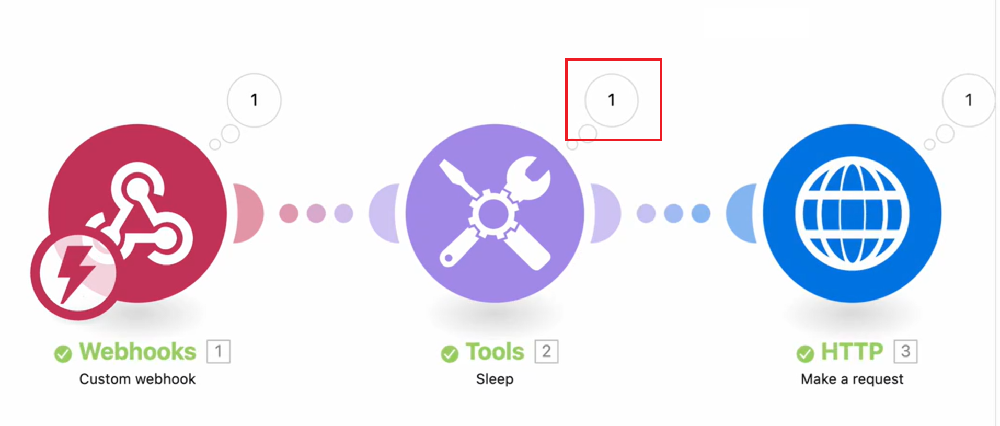

# 查看运行中场景的数据流

您可以观看正在运行的场景，以了解数据如何流经该场景。

>[!NOTE]
>
>Workfront Fusion正在将场景编辑器转换为新Experience。 在此过渡期间，经典体验和新体验均可用，您可以随时在它们之间切换。 我们建议使用新Experience。 有关详细信息，请参阅文章场景编辑器中的[新体验和经典体验](/help/workfront-fusion/get-started-with-fusion/navigate-fusion/scenario-editor.md#new-and-classic-experiences)。

当场景运行时，活动模块会由新版Experience中模块图标上的旋转环来标记，或者由经典Experience中模块周围的生长环来标记。 此环只显示模块正在运行，而不显示其进度。 快速运行的模块可能只显示环的一小部分。

新体验

新版Experience中模块图标上的

经典体验

在经典体验中模块

运行模块后，将显示输出指示器。

新体验

新体验中的

经典体验

传统体验中的

如果模块处理多个缓冲区，则每个已处理的捆绑都会出现环状，并且输出指示符会将其输出的每个捆绑累计。

有关方案数据流的详细信息，请参阅[方案执行流](/help/workfront-fusion/references/scenarios/scenario-execution-flow.md)。

## 访问权限要求

+++ 展开可查看本文所述功能的访问权限要求。

<table style="table-layout:auto">
 <col> 
 <col> 
 <tbody> 
  <tr> 
   <td role="rowheader">Adobe Workfront 包</td> 
   <td> 
任意 Adobe Workfront Workflow 包以及任意 Adobe Workfront 自动化和集成包

Workfront Ultimate

Workfront Prime 和 Select 包，且需额外购买 Workfront Fusion。
 </td> 
  </tr> 
  <tr data-mc-conditions=""> 
   <td role="rowheader">Adobe Workfront 许可证</td> 
   <td> 
标准

工作版或更高版本
 </td> 
  </tr> 
  <tr> 
   <td role="rowheader">产品</td> 
   <td>
   
如果您的组织使用的 Workfront Select 或 Prime 包不包含 Workfront 自动化和集成，则必须单独购买 Adobe Workfront Fusion。</li></ul>
   </td> 
  </tr>
 </tbody> 
</table>

有关此表中信息的更多详细说明，请参阅[文档中的访问权限要求](/help/workfront-fusion/references/licenses-and-roles/access-level-requirements-in-documentation.md)。

+++

## 查看运行中场景的数据流

1. 单击左侧面板中的&#x200B;**[!UICONTROL 方案]**&#x200B;选项卡。
1. 选择要查看数据流的方案。
1. 单击方案上的任意位置以进入方案编辑器。
1. 如果方案未运行，请激活它或单击&#x200B;**运行一次**&#x200B;以开始方案执行。
1. 选择要在执行历史记录面板的“当前正在运行”部分中查看的执行。

