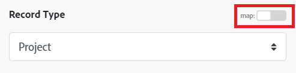

# Workfront Fusion模块

使用Workfront Fusion连接器，您可以从场景中管理自己的Fusion组织。 与将Fusion连接到第三方应用程序或服务的其他连接器不同，此连接器允许场景调用Fusion自己的API，类似于Adobe Workfront连接器允许场景管理Workfront的方式。

有关创建场景的说明，请参阅[创建场景：文章索引](/help/workfront-fusion/create-scenarios/create-scenarios-toc.md)中的相关文章。

有关模块的详细信息，请参阅[模块：文章索引](/help/workfront-fusion/references/modules/modules-toc.md)下的相关文章。

## 访问权限要求

+++ 展开可查看本文所述功能的访问权限要求。

<table style="table-layout:auto">
 <col> 
 <col> 
 <tbody> 
  <tr> 
   <td role="rowheader">Adobe Workfront 包</td> 
   <td> 
任意 Adobe Workfront Workflow 包以及任意 Adobe Workfront 自动化和集成包

Workfront Ultimate

Workfront Prime 和 Select 包，且需额外购买 Workfront Fusion。
 </td> 
  </tr> 
  <tr data-mc-conditions=""> 
   <td role="rowheader">Adobe Workfront 许可证</td> 
   <td> 
标准

工作版或更高版本
 </td> 
  </tr> 
  <tr> 
   <td role="rowheader">产品</td> 
   <td>
   
如果您的组织使用的 Workfront Select 或 Prime 包不包含 Workfront 自动化和集成，则必须单独购买 Adobe Workfront Fusion。</li></ul>
   </td> 
  </tr>
 </tbody> 
</table>

有关此表中信息的更多详细说明，请参阅[文档中的访问权限要求](/help/workfront-fusion/references/licenses-and-roles/access-level-requirements-in-documentation.md)。

+++

## 将Workfront Fusion连接到Workfront Fusion

1. 在任意Workfront Fusion模块中，单击“连接”字段旁边的&#x200B;**[!UICONTROL 添加]**。
1. 填写以下字段：

   <table style="table-layout:auto"> 
    <col> 
    <col> 
    <tbody> 
     <tr> 
      <td role="rowheader">[!UICONTROL 连接类型]</td> 
      <td>Select要创建的连接类型。</td> 
     </tr> 
     <tr> 
      <td role="rowheader">[!UICONTROL 连接名称]</td> 
      <td>输入连接名称。</td> 
     </tr> 
     <tr> 
      <td role="rowheader">[!UICONTROL 客户端 ID]</td> 
      <td>输入您的 [!DNL Adobe] [!UICONTROL 客户端 ID]。 这可以在[!DNL Adobe Developer Console]的[!UICONTROL Credentials]详细信息部分找到。</td> 
     </tr> 
     <tr> 
      <td role="rowheader">[!UICONTROL 客户端密钥]</td> 
      <td>输入您的[!DNL Adobe] [!UICONTROL 客户端密钥]。 这可以在[!DNL Adobe Developer Console]的[!UICONTROL Credentials]详细信息部分找到。</td> 
     </tr> 
     <tr> 
      <td role="rowheader">[!UICONTROL 组织ID]</td> 
      <td>输入您的[!DNL Adobe] IMS组织ID。</td> 
     </tr> 
     <tr> 
      <td role="rowheader">[!UICONTROL 区域]</td> 
      <td>此连接的Fusion区域Select。</td> 
     </tr> 
    </tbody> 
   </table>

1. 点击&#x200B;**[!UICONTROL 继续]**&#x200B;保存连接并返回模块。

## Workfront Fusion模块及其字段

在配置Workfront Fusion模块时，Workfront Fusion会显示以下列出的字段。 模块中的加粗标题表示必填字段。

如果您看到字段或功能上方的映射按钮，可使用它为该字段设置变量和函数。 有关详细信息，请参阅[将信息从一个模块映射到另一个模块](/help/workfront-fusion/create-scenarios/map-data/map-data-from-one-to-another.md)。

* [触发器](#triggers)
* [操作](#actions)
* [导出](#export)
* [杂项](#misc)

### 触发器

* [观察记录](#watch-records)

#### 观察记录

此触发器模块在创建、更新或同时创建、更新Workfront Fusion记录时启动方案。 您可以使用过滤器来关注对团队重要的更改，因此无需手动查看Workfront Fusion。

<table style="table-layout:auto"> 
 <col> 
 <col> 
 <tbody> 
  <tr> 
   <td role="rowheader">[!UICONTROL 连接]</td> 
   <td> 
有关将Workfront Fusion连接到Workfront Fusion的说明，请参阅本文中的<a href="#connect-workfront-fusion-to-workfront-fusion" class="MCXref xref">将Workfront Fusion连接到Workfront Fusion</a>。
 </td> 
  </tr> 
  <tr> 
   <td role="rowheader">观看</td> 
   <td>Select您希望模块关注的更改类型。</td> 
  </tr> 
  <tr> 
   <td role="rowheader">记录类型</td> 
   <td>Select要监视的记录类型： <b>方案</b>或<b>执行</b>。</td> 
  </tr> 
  <tr> 
   <td role="rowheader">方案ID</td> 
   <td>
如果要监视执行，请选择或映射要监视执行的方案。

此字段为可选字段。 如果将其留空，则模块将在整个组织中搜索执行。
</td> 
  </tr> 
  <tr> 
   <td role="rowheader">显示检查运行</td> 
   <td>
如果要监视执行，请选择结果是否包括检查运行：
<ul><li><b>是</b>：包含检查运行。</li><li><b>否</b>：不包含检查运行。</li><li><b>未定义</b>：不按检查运行筛选结果。</li></ul></td> 
  </tr> 
  <tr> 
   <td role="rowheader">筛选</td> 
   <td>在<b>属性</b>下，对于要使用的每个属性筛选器，单击<b>添加项</b>，选择字段和运算符，然后输入或映射要筛选的值。 值字段仅会显示在需要它的运算符中。 例如，<b>Exists</b>之类的运算符不需要值。 Scenario和Execution记录类型的属性筛选器相同。</td> 
  </tr> 
  <tr> 
   <td role="rowheader">限制</td> 
   <td>输入或映射Workfront Fusion在一个执行周期内处理的最大结果数。 默认值为200。</td> 
  </tr> 
 </tbody> 
</table>

### 操作

* [克隆记录](#clone-a-record)
* [创建记录](#create-a-record)
* [删除记录](#delete-a-record)
* [列出记录](#list-records)
* [读取记录](#read-a-record)
* [更新记录](#update-a-record)

#### 克隆记录

此模块制作指定记录的副本。

<table style="table-layout:auto"> 
 <col> 
 <col> 
 <tbody> 
  <tr> 
   <td role="rowheader">[!UICONTROL 连接]</td> 
   <td> 
有关将Workfront Fusion连接到Workfront Fusion的说明，请参阅本文中的<a href="#connect-workfront-fusion-to-workfront-fusion" class="MCXref xref">将Workfront Fusion连接到Workfront Fusion</a>。
 </td> 
  </tr> 
  <tr> 
   <td role="rowheader">记录类型</td> 
   <td> 选择要克隆的记录类型。 </td> 
  </tr> 
  <tr> 
   <td role="rowheader">场景ID/挂接ID/数据结构ID</td> 
   <td> 输入或映射要克隆的项目的ID。 </td> 
  </tr> 
  <tr> 
   <td role="rowheader">名称</td> 
   <td> 输入或映射新方案、挂接或数据结构的名称。</td> 
  </tr> 
 </tbody> 
</table>

#### 创建记录

此模块使用指定的数据创建记录。

<table style="table-layout:auto"> 
 <col> 
 <col> 
 <tbody> 
  <tr> 
   <td role="rowheader">[!UICONTROL 连接]</td> 
   <td> 
有关将Workfront Fusion连接到Workfront Fusion的说明，请参阅本文中的<a href="#connect-workfront-fusion-to-workfront-fusion" class="MCXref xref">将Workfront Fusion连接到Workfront Fusion</a>。
 </td> 
  </tr> 
  <tr> 
   <td role="rowheader">记录类型</td> 
   <td> 选择要创建的记录类型。 </td> 
  </tr> 
  <tr> 
   <td role="rowheader">团队 ID</td> 
   <td> 输入或映射将拥有此记录的团队的ID。 </td> 
  </tr> 
  <tr> 
   <td role="rowheader">名称</td> 
   <td> 输入或映射新记录的名称。</td> 
  </tr> 
 </tbody> 
</table>

#### 删除记录

此模块删除指定的记录。

<table style="table-layout:auto"> 
 <col> 
 <col> 
 <tbody> 
  <tr> 
   <td role="rowheader">[!UICONTROL 连接]</td> 
   <td> 
有关将Workfront Fusion连接到Workfront Fusion的说明，请参阅本文中的<a href="#connect-workfront-fusion-to-workfront-fusion" class="MCXref xref">将Workfront Fusion连接到Workfront Fusion</a>。
 </td> 
  </tr> 
  <tr> 
   <td role="rowheader">记录类型</td> 
   <td> 选择要删除的记录类型。 </td> 
  </tr> 
  <tr> 
   <td role="rowheader">其他字段</td> 
   <td>输入任何其他字段的值。 可用字段取决于所选的记录类型。 </td> 
  </tr> 
 </tbody> 
</table>

#### 列出记录

此模块使用基于游标的分页和属性过滤器返回分页记录列表。

<table style="table-layout:auto"> 
 <col> 
 <col> 
 <tbody> 
  <tr> 
   <td role="rowheader">[!UICONTROL 连接]</td> 
   <td> 
有关将Workfront Fusion连接到Workfront Fusion的说明，请参阅本文中的<a href="#connect-workfront-fusion-to-workfront-fusion" class="MCXref xref">将Workfront Fusion连接到Workfront Fusion</a>。
 </td> 
  </tr> 
  <tr> 
   <td role="rowheader">记录类型</td> 
   <td>选择要返回列表的记录类型。</td> 
  </tr> 
  <tr> 
   <td role="rowheader">字段</td> 
   <td>选择要包含在结果中的任何字段。</td> 
  </tr> 
  <tr> 
   <td role="rowheader">属性</td> 
   <td>对于要返回结果的每个属性筛选器，单击<b>添加项</b>并输入要筛选的字段、运算符和值。</td> 
  </tr> 
  <tr> 
   <td role="rowheader">开始</td> 
   <td>输入要开始返回结果的位置。 用于分页。</td> 
  </tr> 
  <tr> 
   <td role="rowheader">返回结果的最大数目</td> 
   <td>输入或映射每个执行周期您希望模块返回的最大记录数。</td> 
  </tr> 
  <tr> 
   <td role="rowheader">排序方式</td> 
   <td>选择要作为结果排序依据的字段。</td> 
  </tr> 
  <tr> 
   <td role="rowheader">方向</td> 
   <td>选择要按升序或降序排序结果。</td> 
  </tr> 
 </tbody> 
</table>

#### 读取记录

此模块检索指定记录

<table style="table-layout:auto"> 
 <col> 
 <col> 
 <tbody> 
  <tr> 
   <td role="rowheader">[!UICONTROL 连接]</td> 
   <td> 
有关将Workfront Fusion连接到Workfront Fusion的说明，请参阅本文中的<a href="#connect-workfront-fusion-to-workfront-fusion" class="MCXref xref">将Workfront Fusion连接到Workfront Fusion</a>。
 </td> 
  </tr> 
  <tr> 
   <td role="rowheader">记录类型</td> 
   <td> Select要删除的记录类型。 </td> 
  </tr> 
  <tr> 
   <td role="rowheader">其他字段</td> 
   <td>输入任何其他字段的值。 可用字段取决于所选的记录类型。 </td> 
  </tr> 
 </tbody> 
</table>

#### 更新记录

更新指定记录。

<table style="table-layout:auto"> 
 <col> 
 <col> 
 <tbody> 
  <tr> 
   <td role="rowheader">[!UICONTROL 连接]</td> 
   <td> 
有关将Workfront Fusion连接到Workfront Fusion的说明，请参阅本文中的<a href="#connect-workfront-fusion-to-workfront-fusion" class="MCXref xref">将Workfront Fusion连接到Workfront Fusion</a>。
 </td> 
  </tr> 
  <tr> 
   <td role="rowheader">记录类型</td> 
   <td> Select要更新的记录类型。 </td> 
  </tr> 
  <tr> 
   <td role="rowheader">名称</td> 
   <td> 输入或映射记录的新名称。</td> 
  </tr> 
  <tr> 
   <td role="rowheader">ID</td> 
   <td> 输入或映射要更新的记录ID。 </td> 
  </tr> 
 </tbody> 
</table>

### 导出

* [导出活动日志](#export-activity-logs)
* [导出方案](#export-scenarios)

#### 导出活动日志

此模块可导出活动日志。

<table style="table-layout:auto"> 
 <col> 
 <col> 
 <tbody> 
  <tr> 
   <td role="rowheader">[!UICONTROL 连接]</td> 
   <td> 
有关将Workfront Fusion连接到Workfront Fusion的说明，请参阅本文中的<a href="#connect-workfront-fusion-to-workfront-fusion" class="MCXref xref">将Workfront Fusion连接到Workfront Fusion</a>。
 </td> 
  </tr> 
  <tr> 
   <td role="rowheader">文件类型</td> 
   <td>Select您要导出日志的文件格式。</td> 
  </tr> 
  <tr> 
   <td role="rowheader">属性</td> 
   <td>对于要返回结果的每个属性筛选器，单击<b>添加项</b>并输入要筛选的字段、运算符和值。 您还可以按字段是否存在进行筛选。</td> 
  </tr> 
  <tr> 
   <td role="rowheader">开始</td> 
   <td>输入要开始返回结果的位置。 用于分页。</td> 
  </tr> 
  <tr> 
   <td role="rowheader">返回结果的最大数目</td> 
   <td>输入或映射每个执行周期您希望模块返回的最大记录数。</td> 
  </tr> 
  <tr> 
   <td role="rowheader">排序方式</td> 
   <td>Select要作为结果排序依据的字段。</td> 
  </tr> 
  <tr> 
   <td role="rowheader">方向</td> 
   <td>选择要按升序或降序排序结果。</td> 
  </tr> 
 </tbody> 
</table>

#### 导出方案

此模块可导出一个或多个场景的Fusion Blueprint。

<table style="table-layout:auto"> 
 <col> 
 <col> 
 <tbody> 
  <tr> 
   <td role="rowheader">[!UICONTROL 连接]</td> 
   <td> 
有关将Workfront Fusion连接到Workfront Fusion的说明，请参阅本文中的<a href="#connect-workfront-fusion-to-workfront-fusion" class="MCXref xref">将Workfront Fusion连接到Workfront Fusion</a>。
 </td> 
  <tr> 
   <td role="rowheader">方案ID</td> 
   <td>对于每个要导出的方案，单击<b>添加项</b>并输入方案ID。</td> 
  </tr> 
  </tr> 
 </tbody> 
</table>

### 杂项

* [获取挂接的队列统计信息](#get-queue-statistics-for-a-hook)
* [获取记录依赖关系](#get-record-dependencies)
* [列出连接的方案](#list-scenarios-for-a-connection)
* [列出Fusion区域和组织](#list-the-fusion-regions-and-organizations)

#### 获取挂接的队列统计信息

此模块返回指定挂接的队列统计信息：当前已排队的事件的数量、队列限制以及挂接是否已启用。

<table style="table-layout:auto"> 
 <col> 
 <col> 
 <tbody> 
  <tr> 
   <td role="rowheader">[!UICONTROL 连接]</td> 
   <td> 
有关将Workfront Fusion连接到Workfront Fusion的说明，请参阅本文中的<a href="#connect-workfront-fusion-to-workfront-fusion" class="MCXref xref">将Workfront Fusion连接到Workfront Fusion</a>。
 </td> 
  <tr> 
   <td role="rowheader">挂钩ID</td> 
   <td> 输入或映射要为其返回详细信息的挂接的ID。</td> 
  </tr> 
 </tbody> 
</table>

#### 获取记录依赖关系

此模块获取记录的依赖关系。

<table style="table-layout:auto"> 
 <col> 
 <col> 
 <tbody> 
  <tr> 
   <td role="rowheader">[!UICONTROL 连接]</td> 
   <td> 
有关将Workfront Fusion连接到Workfront Fusion的说明，请参阅本文中的<a href="#connect-workfront-fusion-to-workfront-fusion" class="MCXref xref">将Workfront Fusion连接到Workfront Fusion</a>。
 </td> 
  <tr> 
   <td role="rowheader">记录类型</td> 
   <td> Select要检索其依赖关系的记录类型。 </td> 
  </tr> 
  <tr> 
   <td role="rowheader">场景ID/挂接ID</td> 
   <td> 输入或映射要检索其依赖关系的记录的ID。 </td> 
  </tr> 
  </tr> 
 </tbody> 
</table>

#### 获取记录依赖项

此模块确定依赖给定资源的内容。 在删除资源之前，请使用此模块检查是否有任何内容依赖该资源，以及删除是否会影响该资源。

<table style="table-layout:auto"> 
 <col> 
 <col> 
 <tbody> 
  <tr> 
   <td role="rowheader">[!UICONTROL 连接]</td> 
   <td> 
有关将Workfront Fusion连接到Workfront Fusion的说明，请参阅本文中的<a href="#connect-workfront-fusion-to-workfront-fusion" class="MCXref xref">将Workfront Fusion连接到Workfront Fusion</a>。
 </td> 
  </tr> 
  <tr> 
   <td role="rowheader">记录类型</td> 
   <td>选择要检查从属项的记录类型。</td> 
  </tr> 
  <tr> 
   <td role="rowheader">种类</td> 
   <td>选择要检查的依赖项种类……</td> 
  </tr> 
  <tr> 
   <td role="rowheader">ID</td> 
   <td>输入或映射要为其返回依赖项的记录的ID。</td> 
  </tr> 
 </tbody> 
</table>

#### 列出连接的方案

此模块返回引用给定连接的方案的分页列表。

<table style="table-layout:auto"> 
 <col> 
 <col> 
 <tbody> 
  <tr> 
   <td role="rowheader">[!UICONTROL 连接]</td> 
   <td> 
有关将Workfront Fusion连接到Workfront Fusion的说明，请参阅本文中的<a href="#connect-workfront-fusion-to-workfront-fusion" class="MCXref xref">将Workfront Fusion连接到Workfront Fusion</a>。
 </td> 
  </tr> 
  <tr> 
   <td role="rowheader">连接Id</td> 
   <td>输入或映射要为其返回方案的连接的ID。</td> 
  </tr> 
  <tr> 
   <td role="rowheader">属性</td> 
   <td>对于要返回结果的每个属性筛选器，单击<b>添加项</b>并输入要筛选的字段、运算符和值。 您还可以按字段是否存在进行筛选。</td> 
  </tr> 
  <tr> 
   <td role="rowheader">开始</td> 
   <td>输入要开始返回结果的位置。 用于分页。</td> 
  </tr> 
  <tr> 
   <td role="rowheader">返回结果的最大数目</td> 
   <td>输入或映射每个执行周期您希望模块返回的最大记录数。</td> 
  </tr> 
  <tr> 
   <td role="rowheader">排序方式</td> 
   <td>选择要作为结果排序依据的字段。</td> 
  </tr> 
  <tr> 
   <td role="rowheader">方向</td> 
   <td>选择要按升序或降序排序结果。</td> 
  </tr> 
 </tbody> 
</table>

#### 列出Fusion区域和组织

此模块会根据连接中使用的凭据在IMS用户配置文件中的凭据和访问权限，返回连接可以访问的每个Fusion组织的区域和组织ID。

<table style="table-layout:auto"> 
 <col> 
 <col> 
 <tbody> 
  <tr> 
   <td role="rowheader">[!UICONTROL 连接]</td> 
   <td> 
有关将Workfront Fusion连接到Workfront Fusion的说明，请参阅本文中的<a href="#connect-workfront-fusion-to-workfront-fusion" class="MCXref xref">将Workfront Fusion连接到Workfront Fusion</a>。
 </td> 
  </tr> 
 </tbody> 
</table>
